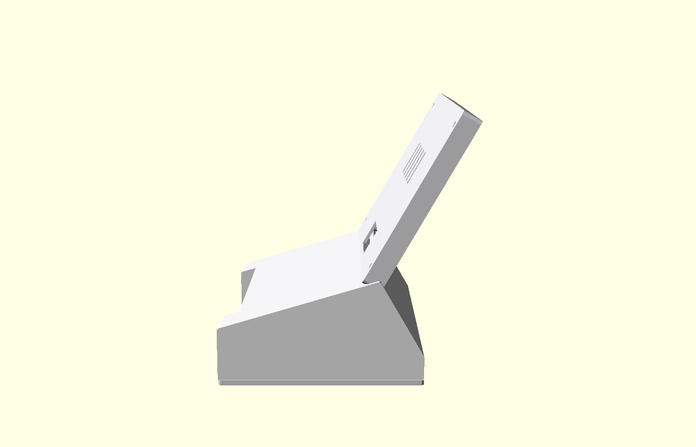

# Desk screen — buy, print, assemble

A 5″ glass panel in a thin printed bezel. The Raspberry Pi is **in the stand**,
not behind the screen. That is the whole point: it should sit like a payment
terminal, not like a Pi bolted to an LCD.



The desk still opens the BoardView website in Chrome, kiosk-only.

Finished screen thickness is **8.7 mm** (glass + PCB + a thin back). Do not
add the 4 mm standoffs or metal Pi bracket that ship with the Waveshare panel —
those exist so you can stack a Pi on the glass, which is the chunky build we
are avoiding.

## Buy (one desk + one board)

**Desk**

| What | Exact name | Notes |
|---|---|---|
| Screen | **[Waveshare 5inch DSI LCD (C)](https://www.waveshare.com/5inch-dsi-lcd-c.htm)** | 1024×600 IPS, capacitive glass. Use the **160 mm** DSI ribbon it ships with. Leave the 50 mm ribbon and the metal Pi stand in the box. |
| Computer | **[Raspberry Pi 4 Model B 2GB](https://www.raspberrypi.com/products/raspberry-pi-4-model-b/)** | Authorized seller (~$45), not the $90 Amazon listing. Goes in the printed stand. |
| Power | Official Pi **USB-C 5.1V / 3A** | Pi 4 brown-outs on phone chargers. |
| Card | 32GB **A2** microSD | SanDisk Extreme or similar. |
| Screws | **M2.5 × 8mm**, pack of 20 | Screen back, Pi, stand lid. |

**Camera (the board)**

| What | Exact name |
|---|---|
| Board | Raspberry Pi Zero 2 W |
| Camera | Arducam Camera Module 3 Wide (IMX708 AF) **+ case + 22–22 cable** |
| Card | 32GB A2 microSD |
| Power | USB-C 5V / 2.5A+ wall charger |

**Don’t buy:** e-ink, color e-ink, the 5″ HDMI LCD (driver board makes it thick), a Pi 5, a used phone, or any “LCD + Pi stacked on the back” kit.

## Print

`case.scad` — PETG, 0.2 mm layers, 20% infill. Bezel, back, and lid flat on the bed; base on its bottom.

```
openscad -o stl/bezel.stl -D 'part="bezel"' case.scad
openscad -o stl/back.stl  -D 'part="back"'  case.scad
openscad -o stl/base.stl  -D 'part="base"'  case.scad
openscad -o stl/lid.stl   -D 'part="lid"'   case.scad
```

Light gray filament. Four parts: front bezel, thin screen back, stand, stand lid.

If the first print is tight on the glass, bump `gap` at the top of the OpenSCAD file. If a chip on the PCB kisses the back, bump `comp_z` by 0.5 mm — **never** by the height of a Pi.

## Assemble

1. Glass faces out of the bezel. PCB corner holes line up with the four bosses. **No Pi on this side.**
2. DSI **160 mm** ribbon through the large hole in the back (the connector itself sits in that hole, then the ribbon drops into the stand). 4× M2.5 through back → PCB → bezel.
3. Pi 4 in the stand, USB-C out the back. Other end of the ribbon to the Pi’s **DSI** port (the display ribbon, not the camera one).
4. Screen drops into the stand slot at ~60°. The only bulk on the desk is the stand.

## Pi software (desk)

Raspberry Pi Imager → Raspberry Pi OS (64-bit). On first boot, add this to `/boot/firmware/config.txt` (the `7_0_inchC` name is correct — same 1024×600 panel as their 7″ C):

```
dtoverlay=vc4-kms-v3d
dtoverlay=vc4-kms-dsi-waveshare-panel,7_0_inchC
```

Then kiosk the student URL (pair the desk in the teacher app first):

```
chromium --kiosk --app=https://YOUR-SITE/screen/s/TOKEN
```

Touch works over the DSI cable. No extra driver for current Raspberry Pi OS.
